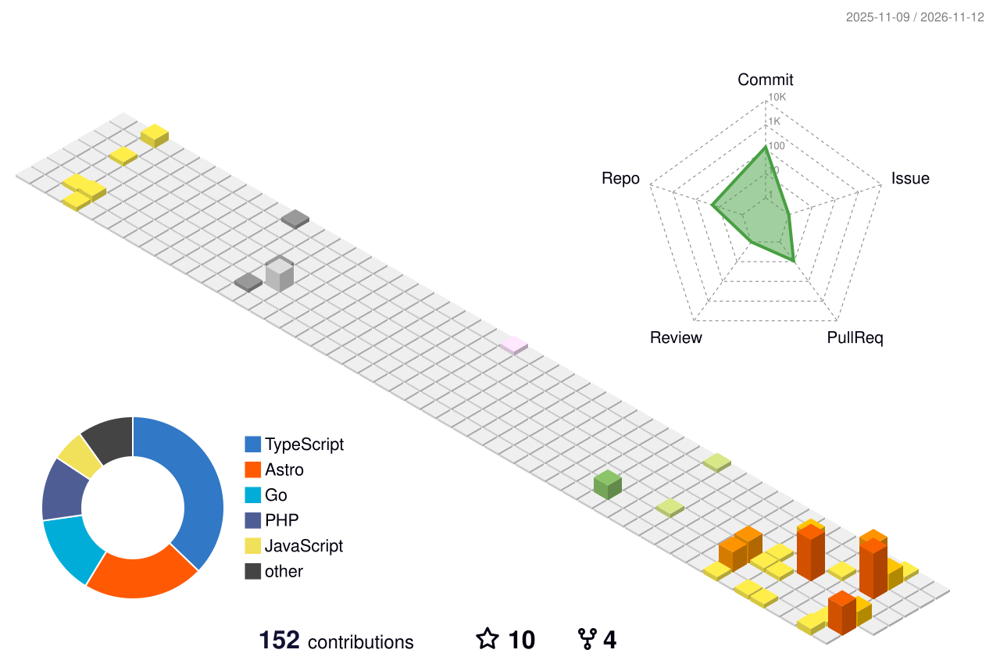

<!--
  Profile README for https://github.com/programmer-bell
  3D contribution graphic is already generated by the existing profile-3d workflow.
  GitHub Profile Summary Cards are generated by the workflow in .github/workflows/.
-->

  

<h1 align="center">Hi, I'm Bell 👋</h1>

<h3 align="center">Backend Engineer · System Architecture · DevOps Engineering</h3>

  I build backend services, explore system design, and automate cloud infrastructure.
   
  This GitHub is my engineering lab for practical projects, technical experiments, and continuous learning.

  
  
  

---

## 🧭 What I Work On

<table>
  <tr>
    <td width="33%" align="center">
      <h3>⚙️ Backend Engineering</h3>
      APIs, application design, data modeling, and reliable services.
    </td>
    <td width="33%" align="center">
      <h3>🏗️ System Architecture</h3>
      System design, architecture patterns, scalability, and trade-offs.
    </td>
    <td width="33%" align="center">
      <h3>☁️ DevOps Engineering</h3>
      Containers, CI/CD, cloud deployment, and infrastructure as code.
    </td>
  </tr>
</table>

## 🧑‍💻 Languages

  &nbsp;&nbsp;
  &nbsp;&nbsp;
  &nbsp;&nbsp;
  &nbsp;&nbsp;
  &nbsp;&nbsp;
  

## 🧩 Frameworks & Runtime

  &nbsp;&nbsp;
  &nbsp;&nbsp;
  &nbsp;&nbsp;
  &nbsp;&nbsp;
  &nbsp;&nbsp;
  &nbsp;&nbsp;
  

## 🗄️ Databases & Data

  &nbsp;&nbsp;
  &nbsp;&nbsp;
  

  

## ☁️ Cloud, DevOps & Infrastructure

  &nbsp;&nbsp;
  &nbsp;&nbsp;
  &nbsp;&nbsp;
  &nbsp;&nbsp;
  &nbsp;&nbsp;
  &nbsp;&nbsp;
  

## 🧰 Developer Tools

  &nbsp;&nbsp;
  

---

## 📊 GitHub at a Glance

  

  
  &nbsp;
  

## 🧊 3D Contribution Activity

  

---

  <i>Design thoughtfully. Build reliably. Automate consistently. Keep learning.</i>

  

